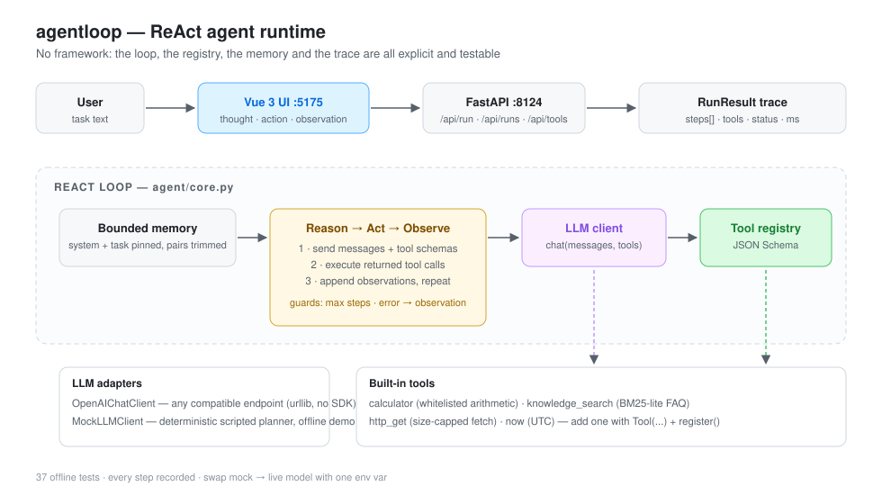
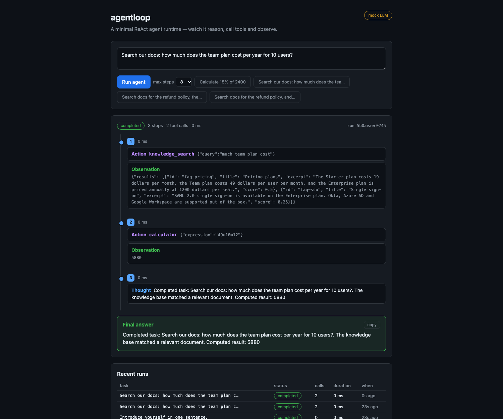
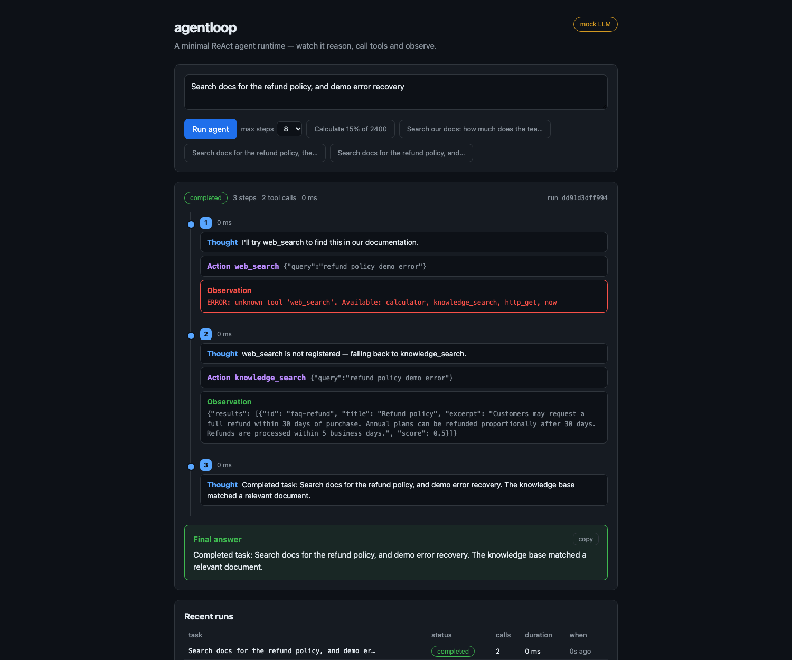
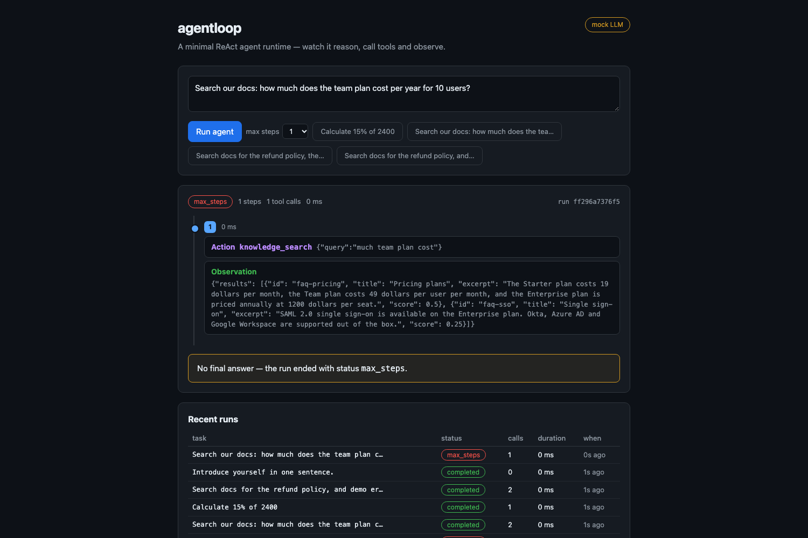
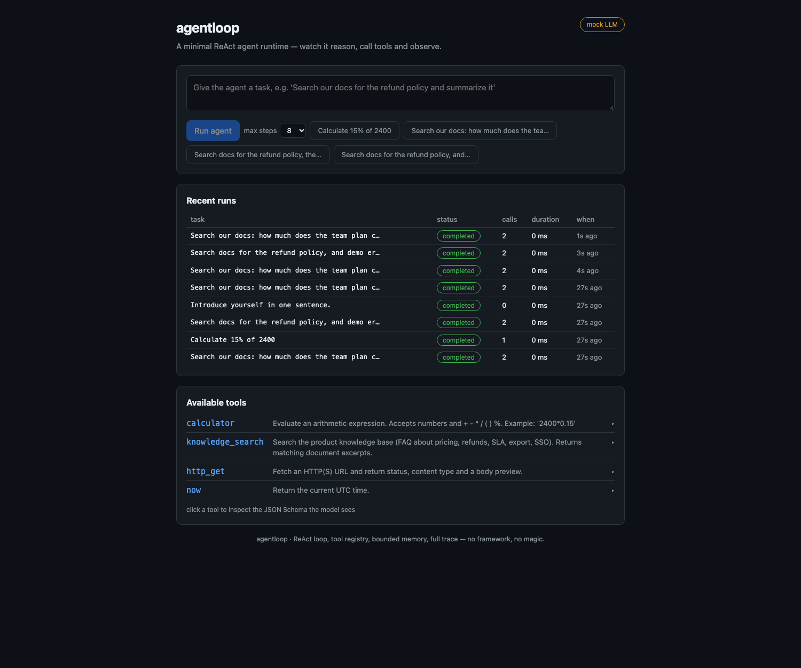
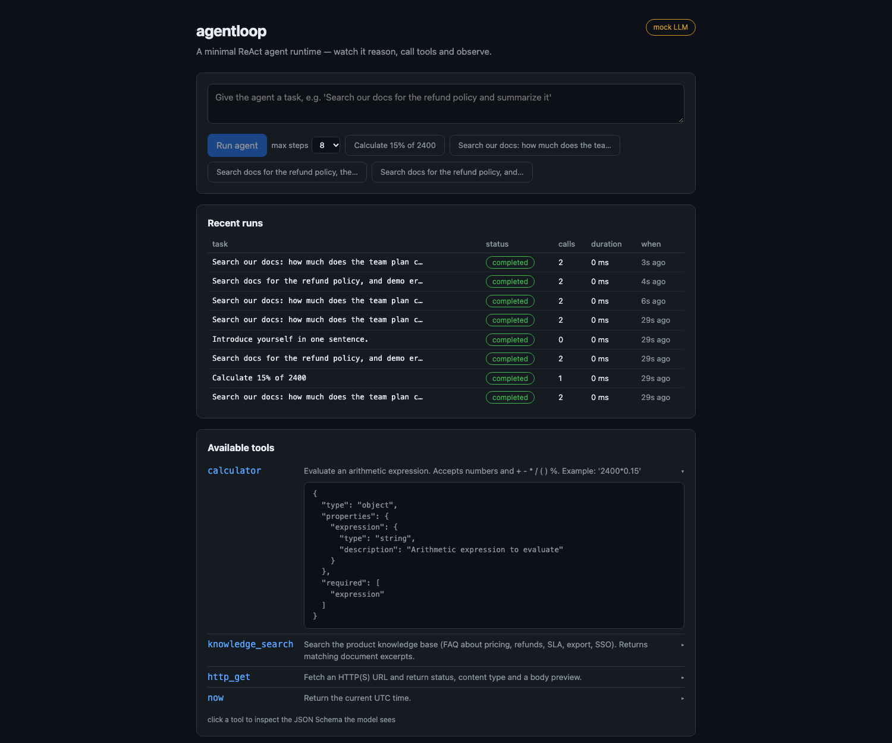

# agentloop





**A minimal ReAct agent runtime, built from scratch** — tool registry, reason-act-observe loop, bounded conversation memory, full execution tracing. No LangChain, no framework: ~700 lines of Python that make the mechanics of LLM agents explicit.

## Screenshots

| | |
|---|---|
|  |  |
|  |  |

The guard rails in action: a hallucinated `web_search` call comes back as `ERROR: unknown tool 'web_search'. Available: …` and the agent reads it and self-corrects; the max-steps guard stops a run that would otherwise spiral, and the UI says why. Every run lands in a timestamped history, and the tool inventory doubles as live JSON-Schema documentation.

## Why no framework

Most agent tutorials hand you `initialize_agent(...)` and hide everything interesting. This project implements the loop itself so every moving part is visible and testable:

- **Tool registry** — callables described by JSON Schema in the OpenAI function-calling format. Malformed arguments, unknown tools and tool exceptions never crash the loop: they become `ERROR: ...` observations the model can read and recover from.
- **ReAct loop** (`agent/core.py`) — send messages + tool schemas to the LLM; if it answers with tool calls, execute them, append observations, repeat; otherwise accept the final answer. Guards: max steps, per-call failure handling.
- **Bounded memory** (`agent/memory.py`) — the system prompt and task stay visible; the oldest (assistant, tool) pairs are trimmed together so observations stay attached to the calls that produced them.
- **Pluggable LLM** (`agent/llm.py`) — any OpenAI-compatible `/chat/completions` endpoint via a dependency-free `urllib` client, or a **deterministic mock planner** that runs the same ReAct trajectory offline (demo needs no API key; production flips to a real model with one env var).

## Quick start

```bash
make install          # backend venv + frontend npm packages
make test             # 47 tests, fully offline
make serve            # backend on :8124 — mock LLM unless OPENAI_API_KEY is set
make dev              # UI on :5175 (proxies /api to :8124)
```

Open http://localhost:5175, pick an example task, and watch the Thought → Action → Observation timeline.

Demo URL hooks: `/?task=<text>` auto-runs the agent, `&max_steps=1` shows the max-steps guard, `&tool=calculator` pre-expands a tool's JSON Schema (used for the screenshots above).

To run against a real model:

```bash
export OPENAI_API_KEY=sk-...
export OPENAI_MODEL=gpt-4o-mini        # default
export OPENAI_BASE_URL=...             # optional: DeepSeek, vLLM, Ollama, ...
make serve
```

## Built-in tools

| Tool | Purpose |
|---|---|
| `calculator` | Arithmetic evaluation behind a strict charset whitelist (no `eval` of arbitrary code) |
| `knowledge_search` | BM25-lite search over a small product FAQ corpus |
| `http_get` | Size-capped HTTP fetch (status, content type, body preview) — refuses loopback/private/link-local targets (SSRF guard) |
| `now` | Current UTC time |

New tools are one `Tool(name, description, parameters, fn)` + `registry.register(...)` away — the schema is what the model sees.

## API

| Endpoint | Description |
|---|---|
| `POST /api/run` | Run a task `{task, max_steps}`; the cap is honored by the loop; returns the full trace |
| `GET /api/runs` | Recent runs, newest first, timestamped; server keeps the last 100 |
| `GET /api/runs/{id}` | Full trace of one run: steps, thoughts, calls, observations |
| `GET /api/tools` | Tool inventory incl. the JSON Schema each tool exposes |
| `GET /api/health` | `llm_mode: "mock" \| "openai"` |

### Example

```bash
curl -s localhost:8124/api/run -H 'Content-Type: application/json' \
  -d '{"task": "Search our docs: how much does the team plan cost per year for 10 users?"}' | jq .
```

The mock planner answers this with a real two-tool trajectory: `knowledge_search` (finds the pricing doc) → `calculator` (49 × 10 × 12) → final answer. It also scripts the failure path: tasks mentioning "recover" first call an unregistered tool, read the `ERROR` observation, and self-correct — the guard-rail story, offline.

## Architecture

```
web/  Vue 3 + TS          thought/action/observation timeline, run meta, tool inventory
 │
api/  FastAPI             /api/run · /api/runs · /api/tools · /api/health
 │
agent/                    the runtime — no framework, no magic
 ├─ core.py    ReActAgent loop, Step/RunResult trace model
 ├─ llm.py     OpenAIChatClient (urllib) · MockLLMClient (scripted planner)
 ├─ memory.py  bounded window, pair-trimmed
 └─ tools.py   Tool + ToolRegistry (JSON Schema, error-safe execution)
 └─ tools/builtin.py        calculator · knowledge_search · http_get · now
```

## Testing

47 offline tests cover the registry contract (bad JSON, missing args, exceptions → observations), memory trimming (original task stays visible, pairs never split), the loop itself (scripted multi-step LLM, observation feedback, unknown-tool recovery, max-steps guard, provider failure), the mock's error-recovery trajectory, the SSRF guard, and every API endpoint via `TestClient`.

```bash
make test
```

## Related projects

- **[docmind-rag](https://github.com/yang-2301/docmind-rag)** — hybrid RAG with evaluation harness
- **[triagedesk](https://github.com/yang-2301/triagedesk)** — full-stack support desk with automatic triage
- **[flowpilot](https://github.com/yang-2301/flowpilot)** — config-driven automation engine
